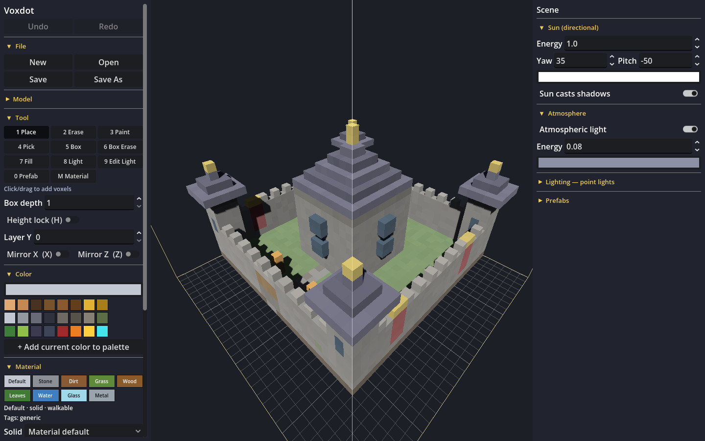
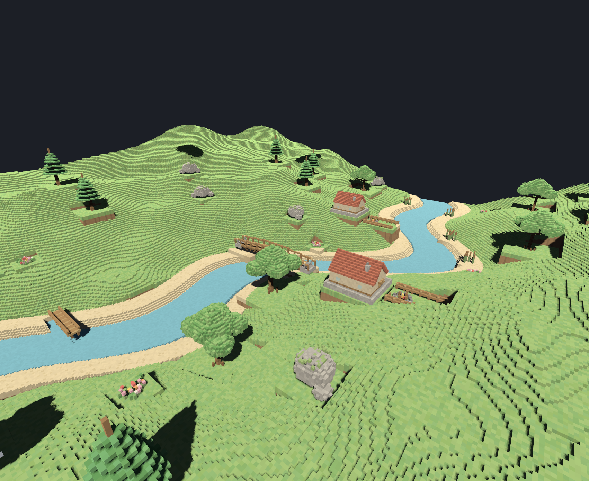
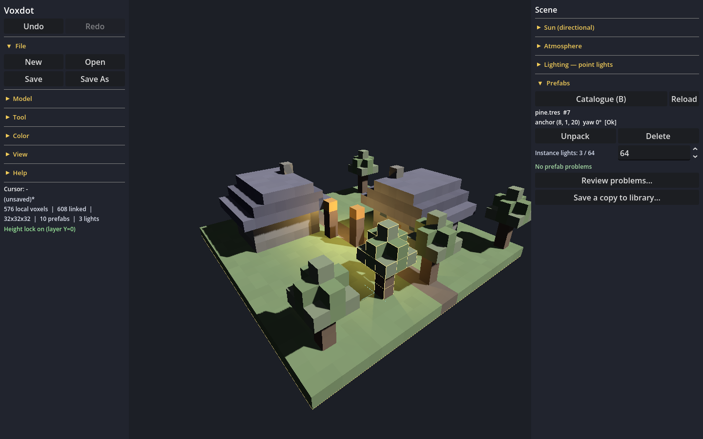
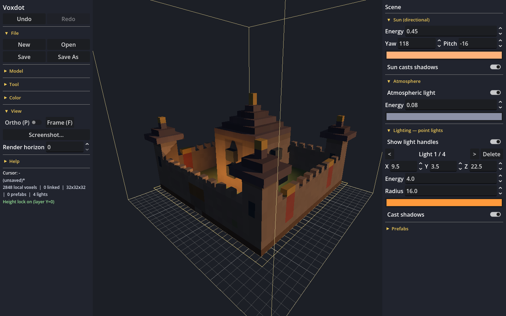
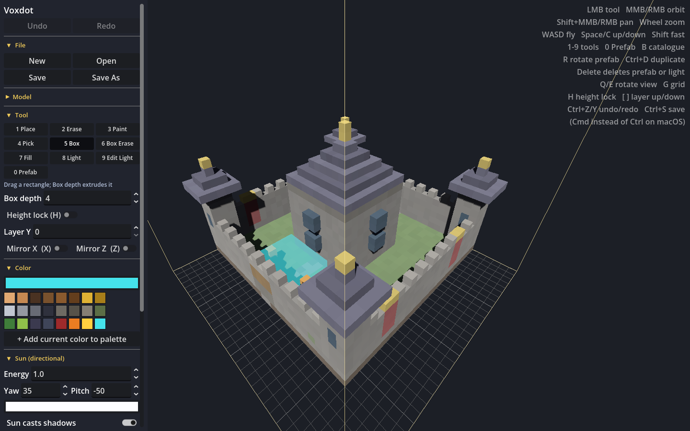
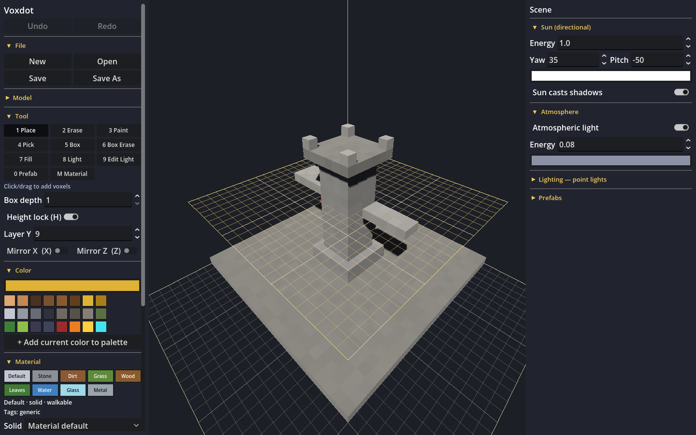

# Voxdot

[](LICENSE)
[](https://godotengine.org)
[](https://github.com/teomurgi/voxdot/actions/workflows/tests.yml)

A standalone voxel model editor built on [Godot](https://godotengine.org) 4.7. Sculpt blocky voxel models, light them
with a directional sun and point lights, save them as Godot `.tres` resources, and drop them into any Godot game.
Build scenes by placing saved models as linked prefab instances that stay in sync with their sources.



## Run

```bash
./run.sh                 # from source, with the system `godot`
./run.sh castle.tres     # ...opening a model

./build.sh               # builds for all platforms -> dist/*.zip, dist/*.tar.gz
./build.sh linux         # just Linux
dist/voxdot-linux-x86_64/voxdot castle.tres

./install.sh             # build Linux + install for your user: `voxdot` command, launcher entry, icon
```

`build.sh` needs no Godot export templates. It exports the app data once
(`voxdot.pck`), then downloads the official Godot runtimes for Windows and
macOS (cached in `dist/downloads/`) and pairs each with the `.pck` and a small
launcher. The Linux build uses the system's Godot runtime. Unzip anywhere and
run: `voxdot` (Linux), `voxdot.bat` (Windows), or `Voxdot.app` (macOS — first
launch may need right-click → Open since the app is unsigned). You can also
drag a `.tres` onto the window to open it.

## Controls

| | |
|---|---|
| Tools `1`-`9`, `M`, `0`, `K` | Place, Erase, Paint, Pick, Box, Box Erase, Fill, Light, Edit Light / Material / Prefab / Character |
| `B` | open the prefab catalogue |
| Prefab gestures | click an instance to select, drag to move, `R` rotate 90°, `Ctrl+D` duplicate, `Delete` delete, `Esc` cancel/clear |
| Material | pick a palette material; the Material tool repaints existing voxels; Solid/Walkable overrides are per-voxel; Pick samples color + material |
| Character | pick a class preset, assign saved `.tres` part models per slot (helmet/chest/main_hand/off_hand; empty = procedural). Characters are authored in the rest T-pose; Walk/Run/Attack are unsaved reference previews that lock voxel editing and settle back to T-pose |
| Animation | flipbook frames: duplicate the current frame and paint the next pose; per-frame seconds, Once/Loop/Ping-pong repeat, Play frames (voxels change — painting is refused while playing or while a character preview runs); rig previews stay in the Character section |
| Fly through the scene | hold `W` `A` `S` `D` relative to the view; `Space` / `C` for up / down; hold `Shift` to move faster |
| Screenshot… | View-section button saves a PNG without the HUD, grid, bounds, or editing overlays |
| `Q` `E` | rotate view 90 degrees |
| `P` / `G` / `F` | ortho toggle / grid toggle / frame model |
| `H` | height lock: Place and Box target the plane at layer Y, so you can build in mid-air |
| `[` `]` (or PageDown/Up) | lower / raise the work layer (turns the lock on) |
| `X` `Z` | mirror across X / Z |
| Delete | remove the selected prefab instance or light |
| `Ctrl+Z`, `Ctrl+Shift+Z` / `Ctrl+Y` | undo / redo (one drag = one step) |
| `Ctrl+N` `Ctrl+O` `Ctrl+S` (`+Shift` = Save As) | new / open / save |

## MCP server (agent control)

Voxdot embeds an [MCP](https://modelcontextprotocol.io) server so an agent can drive every user-visible action
while you watch it happen in the window. It is off by default; enable it with a port:

```bash
VOXDOT_MCP_PORT=7850 ./run.sh            # from source
VOXDOT_MCP_PORT=7850 dist/voxdot          # a build
```

That serves JSON-RPC 2.0 over HTTP on `http://127.0.0.1:7850/` (methods `initialize`, `tools/list`, `tools/call`).
Every tool mirrors a UI action, so the window shows the tool switch, ghost preview, camera move, and status line
as the agent works. Highlights: `set_tool`, `set_color`, `place`/`erase`/`paint`/`fill`, `place_box`,
`begin_stroke`/`update_stroke`/`end_stroke` (a drag, as one undo step), `undo`/`redo`, `open`/`save`,
`set_mirror`/`set_height_lock`/`set_bounds`, `set_camera`/`orbit`/`pan`/`zoom`/`frame`, `set_render_horizon`,
lighting control (`add_light`/`update_light`/`remove_light`/`get_lights`/`select_light`/`set_light_handles`,
`set_sun`), voxel materials (`list_materials`/`set_material`/`get_material`/`get_voxel`/`paint_material`),
prefab control (`prefab_list_assets`/`prefab_refresh_assets`/`prefab_get_asset`/`prefab_set_pivot`/
`prefab_reset_pivot`, `prefab_place`/`prefab_list_instances`/`prefab_get_instance`/`prefab_move`/`prefab_rotate`/
`prefab_duplicate`/`prefab_delete`/`prefab_unpack`/`prefab_relink`/`prefab_reload`/`prefab_get_state`,
`get_composed_voxels`), plus `get_state`, `get_voxels` and `screenshot` so the agent can read back and *see* the
result. `prefab_place` uses an explicit `allow_over_budget` flag instead of opening a modal dialog.
Character rig control (`character_get_state`/`character_set_preset`/`character_set_slot`/
`character_set_anim_state`/`character_play_attack`) drives the 13-bone preview rig: class presets, saved-model
slot paths, and Walk/Run/Attack reference previews (never saved; voxel editing locks while one runs and the rig settles back to the authored T-pose). Flipbook control (`anim_get_state`/`anim_add_frame`/
`anim_delete_frame`/`anim_set_frame`/`anim_set_frame_time`/`anim_set_mode`/`anim_play`/`anim_stop`) edits
whole-model voxel frames with per-frame timing and once/loop/ping-pong repeat.
`GET /health` returns a status blob. Example:
curl -s -X POST http://127.0.0.1:7850/ -d '{"jsonrpc":"2.0","id":1,"method":"tools/call",
  "params":{"name":"place_box","arguments":{"from":[4,0,4],"to":[7,3,7],"color":"e03a3a"}}}'
```

Tests: `VOXDOT_MCP_PORT=7851 godot --headless --path . -s tests/mcp_server_test.gd`.

Box depth extrudes Box / Box Erase. Model size (up to 1024 per axis) and real-world voxel size are in the panel.
Shrinking the size is refused if voxels would be cut off. **Fit bounds to content** shrinks or grows W/H/D to the
furthest occupied cell (the origin stays at 0). Files default to `~/Documents/voxdot`.
The panel sections are collapsible — click a section header to fold it away. File, Model, Tool, Color, Material,
View and Help live in the left panel; Sun, Atmosphere, point lights, Prefabs and Character live in the right **Scene** panel.
Model, point lights, Prefabs and Help start folded so the common controls fit without scrolling.

## Voxel materials

Every voxel references a built-in material: Default, Stone, Dirt, Grass, Wood, Leaves, Water, Glass or Metal.
Materials define **solid** (collision), **walkable** and tags. Voxels can override solid/walkable individually:

- **Place** uses the active material and override selections from the Material section.
- **Material** (`M`) repaints existing voxels without changing their colors.
- **Pick** samples the color, material and overrides under the cursor.
- Old color-only models load as the default material; the metadata is stored as compact parallel byte arrays
  (`material_ids`, `material_overrides`) aligned with the existing cell records.

At runtime, `VoxelModelInstance` builds collision only from solid cells (water and other non-solid materials
still render), `walkable_cells()` returns the exposed top surfaces, and `is_solid_cell()` / `is_walkable_cell()`
query the composed result including prefab instances. `VoxelModel.build_solid_grid()` and
`build_collision_mesh()` expose the same data directly.

## Lighting

Every model carries its own scene mood, so a lit scene reopens exactly as you left it:

- **Sun** (Sun section) — one directional light with energy, yaw/pitch, color, and a shadow toggle.
- **Atmosphere** (Atmosphere section) — ambient fill light with an enable toggle, energy and color. It lifts
  unlit faces without affecting the directional sun; the color/energy are saved with the model.
- **Point lights** (Lighting section, tools `8` Light / `9` Edit Light) — up to 32 lights with position, color,
  energy, radius, and shadows. Drag a light's handle to move it, `Delete` removes the selected one, `<`/`>` cycle.

All three live in the `.tres` (`VoxelModel.lights` plus the `sun_*` and `atmosphere_*` fields) and are available
over MCP (`add_light`, `update_light`, `set_sun`, …). Point-light edits are undoable; sun and atmosphere settings
are scene-wide and save with the model like the mirror flags.

**Render horizon** (View section) caps how much of a big model gets meshed: only chunks within that horizontal
distance of the camera are rendered, and it follows the camera as you fly. Raising it reveals *farther* parts;
`0` renders everything. The full grid is always kept and saved, so this is purely a display setting.

## Prefabs

Any saved model can be reused as a **linked prefab instance** inside another model. Press `B` to open the
catalogue: a searchable thumbnail grid over two libraries — `~/Documents/voxdot/Prefabs` (user) and
`Prefabs/` next to the open model (project). The details pane sets a custom **pivot** in source cell space
(multiples of 0.5), either with the numeric fields or by clicking in the preview. Each asset gets a stable ID
and its metadata lives in `<library>/.voxdot/catalogue.cfg`; thumbnails are cached under `user://prefab_thumbs/`.

- **Linked, not copied.** An instance stores the source as a native Godot external reference plus a
  parent-relative fallback path. Editing the source changes every placement after reopening the parent or
  pressing **Reload** in the Prefabs section (there is no filesystem watcher).
- **Atomic gestures.** Click to select, drag to move, `R` to rotate 90°, `Ctrl+D` to duplicate, `Delete` to
  remove. Moves, rotations and placements are all-or-nothing: they are refused if any voxel or light would
  overlap another instance/local voxel or leave the model bounds. Translation is integer-cell and yaw is
  limited to 90° steps; there is no scale or mirror per instance.
- **Build on, don't edit.** Place/Box can add ordinary voxels in empty cells adjacent to a prefab surface.
  Paint/Erase/Fill/Box Erase refuse linked cells with “unpack to edit”. **Unpack** converts one instance into
  editable voxels and point lights in a single undo step (refused if the parent's 32-light limit would be
  exceeded).
- **Voxels and point lights travel with the prefab.** The parent owns the sun, physical voxel size and palette.
  Instance lights are kept and counted against a soft budget (default 64); going over warns and asks for an
  explicit override, but never drops a light.
- **No nesting.** A model that contains prefab instances cannot itself be used as a prefab source.
- **Broken sources are safe.** A missing source, an overlapping external edit, or a newly nested source becomes
  a red wireframe placeholder. The instance survives saving and can be moved, deleted or **relinked** to a new
  file; conflicted instances contribute no geometry until resolved.

In a game, ship the parent together with its `Prefabs/` folder and use `VoxelModelInstance` (or
`VoxelModel.build_mesh()`), which composes linked cells and lights into one mesh. If the folder moved as a unit,
`VoxelModel.load_with_prefabs(path)` re-resolves sources from the saved relative paths; missing sources are
skipped with a warning (set `VoxelModelInstance.show_missing_prefabs` to draw debug boxes).

## Screenshots

**Sunny valley (512³)** — a prefab-composed diorama: the parent holds only shaped terrain and water, and every
added element (oaks, pines, log cabins with stone foundations, arched bridge, jetty, boulders, flower/reed
patches, fire pits, fences, clouds, sun) is a linked prefab instance. Built by `tools/build_valley_512.py` over
MCP: terrain reserves are levelled first, then each source is saved under `Prefabs/` and placed with
`prefab_place`. The winding river, homesteads, and meadows below are all composed live in the editor.



**Prefabs** — linked cottages, pines and lamps composed over a meadow. The selected pine shows its outline and
pivot, and the Prefabs section reports the instance's anchor, yaw, state and light usage.



**Lighting** — a dusk sun plus four warm point lights, authored in the Sun/Lighting sections and saved with the



**Box tool** — drag a rectangle and the ghost shows exactly the block that will be placed, extruded to the
depth you set.



**Height lock** — with the lock on, Place and Box land on the golden work plane, so you can build a floor or a
bridge at an exact layer without stacking voxels up to reach it.



The screenshots are generated by `tools/make_screenshots.gd`, which drives the editor scene and saves the
rendered frames:

```bash
godot --path . -s tools/make_screenshots.gd
```

## Using models in a game

Voxdot is a standalone tool: new files default to `~/Documents/voxdot`.
Choose your game project folder explicitly when authoring for a game (for RPG Forge,
`godot/resources/`), or open an existing model by path. No asset-copy step is required. Prefab dependencies
and character slot paths in `.tres` saves are relative to their containing model;
Save As rebases links without copying the linked assets. Keep related `Prefabs/`
and `Parts/` folders together when moving a world.

Copy these runtime scripts into your Godot project, keeping `voxel_model.gd` at **`res://scripts/editor/voxel_model.gd`**
(saved `.tres` files reference that path):

- `scripts/editor/voxel_model.gd`
- `scripts/editor/voxel_mesh_builder.gd`
- `scripts/editor/voxel_material.gd`
- `scripts/editor/voxel_prefab_instance.gd` (only needed for models that use prefabs)
- `scripts/runtime/voxel_model_instance.gd` (optional)
- `scripts/editor/voxel_character_parts.gd` and `scripts/runtime/voxel_character_visual.gd` (character presentation)

Then either add a `VoxelModelInstance` node and assign the model (optional trimesh collision), or in code:
`var mesh: ArrayMesh = (load("res://castle.tres") as VoxelModel).build_mesh()`. The mesh is scaled to the model's
`voxel_size` and uses vertex colors with the shared material from `VoxelMeshBuilder.get_material()`.
`VoxelModel.to_grid()` returns the raw `{Vector3i: Color}` grid; `build_composed_grid()` and
`build_composed_lights()` include linked prefab content.

Models can also store point lights (`VoxelModel.lights`, packed) and a directional sun (`sun_energy`,
`sun_yaw`, `sun_pitch`, `sun_color`, `sun_shadows`) so lit scenes reopen exactly as authored.
`VoxelModelInstance` rebuilds the lights as `OmniLight3D`s scaled to `voxel_size`; the sun is applied by
the voxdot editor — runtime scenes use their own lighting. Old models without these fields load unchanged.

Prefab sources are ordinary Godot dependencies. Keep the `Prefabs/` folder next to the parent; for a folder that
was moved as a unit, call `VoxelModel.load_with_prefabs("res://castle.tres")` instead of `load()` so the saved
relative paths can re-resolve. Missing sources are skipped at runtime with a warning (the editor keeps a
placeholder).

`VoxelCharacterVisual` shares the preview rig with RPG Forge. Its `appearance`
resource / `apply_model_loadout()` API applies saved procedural style and model
slots, resolving paths relative to the containing model. Gameplay owns movement,
damage and attack eligibility; the shared rig supplies poses, timing events and
cancellation. `VoxelModelInstance` plays flipbooks (Once/Loop/Ping-pong); collision
and material queries remain on frame zero while prefabs/lights persist.

## Tests

```bash
godot --headless --path . --import
godot --headless --path . -s tests/voxel_document_test.gd         # data layer incl. prefabs
godot --headless --path . -s tests/voxel_editor_test.gd           # tools, standalone behaviour
godot --headless --path . -s tests/voxel_prefab_catalog_test.gd   # libraries, IDs, pivots, manifests
godot --headless --path . -s tests/voxel_prefab_editor_test.gd    # catalogue + instance editing end-to-end
godot --headless --path . -s tests/voxel_editor_input_test.gd     # real input events
VOXDOT_MCP_PORT=7851 godot --headless --path . -s tests/mcp_server_test.gd  # MCP server over HTTP
```

## Layout

```
scripts/editor/   VoxelDocument (edits, undo, IO), VoxelModel (resource), VoxelRaycast, VoxelModelEditor (UI, tools), VoxelMeshBuilder,
                  VoxelPrefabInstance / VoxelPrefabComposition / VoxelPrefabCatalog / VoxelPrefabRig / VoxelPrefabCatalogDialog
scripts/runtime/  VoxelModelInstance (drop-in node for games)
scenes/voxdot.tscn   main scene
packaging/        launcher scripts (Linux/Windows/macOS), .desktop file, Info.plist
```

## Contributing

Bug reports and pull requests are welcome. Please read [CONTRIBUTING.md](CONTRIBUTING.md) first: it covers the
code layout, the style rules, how to add a tool, and the one file you must not move
(`scripts/editor/voxel_model.gd`, because saved models reference it by path).

## License

MIT — see [LICENSE](LICENSE). The `VoxelModel` format is intentionally simple and stable so that models
saved here stay loadable in other Godot projects.

